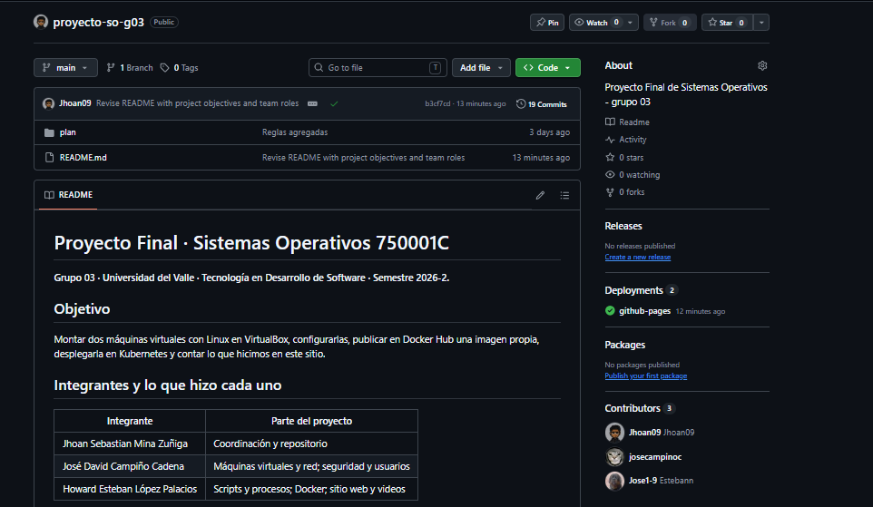
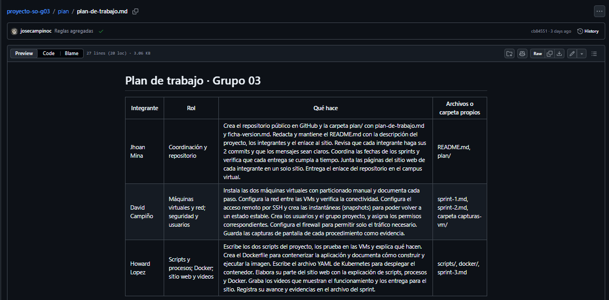
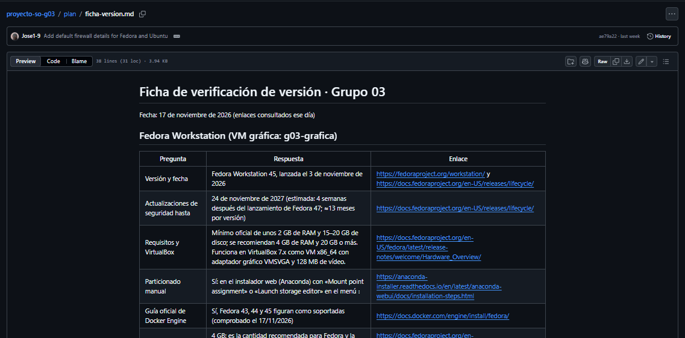
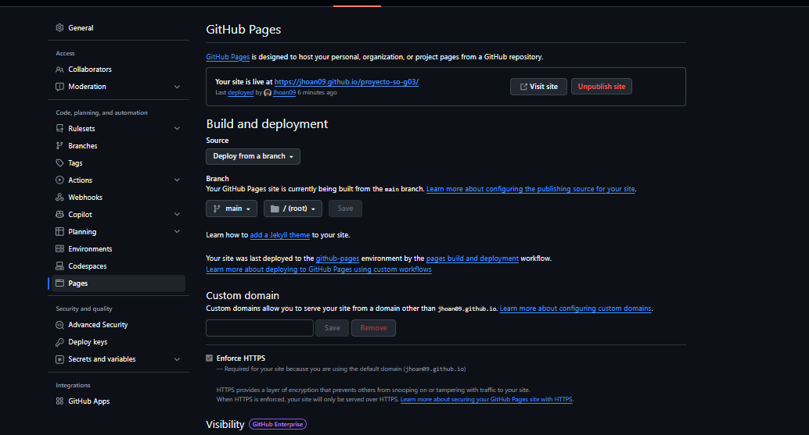

# Sprint 0 · Arranque

[Volver al inicio](README.md)

- **Qué se pide (2 partes):** repositorio público con la carpeta `plan` (0,15) y los archivos `plan-de-trabajo.md` y `ficha-version.md` completos y coherentes (0,15).
- **Qué se entrega en el campus:** el enlace del repositorio.
- **Repositorio:** [github.com/Jhoan09/proyecto-so-g03](https://github.com/Jhoan09/proyecto-so-g03)
- **Sitio:** [jhoan09.github.io/proyecto-so-g03](https://jhoan09.github.io/proyecto-so-g03/)
- **Responsable:** Jhoan Mina (coordinación y repositorio).

## 1. Repositorio público con la carpeta plan

**Qué hicimos:** Creamos el repositorio público `proyecto-so-g03` en GitHub. Tiene un `README.md` en la raíz, con el objetivo, los integrantes y las distribuciones, y la carpeta `plan/` con los archivos `plan-de-trabajo.md` y `ficha-version.md`.

Pasos:
1. Abrimos https://github.com/new, escribimos el nombre `proyecto-so-g03` y dejamos la visibilidad en **Público**.
2. Activamos **Add a README file** y pulsamos **Create repository**.
3. Con **Add file → Create new file** creamos `plan/plan-de-trabajo.md` y `plan/ficha-version.md`. Al escribir una barra en el nombre, GitHub crea la carpeta `plan`.

**Explicación:** Imagen del repositorio Creado

## 2. Plan de trabajo

**Qué hicimos:** Repartimos el trabajo en tres roles y escribimos las reglas del equipo y las fechas de los sprints. El archivo completo está en [plan/plan-de-trabajo.md](plan/plan-de-trabajo.md).

| Integrante | Rol | Archivos o carpetas propios |
| --- | --- | --- |
| Jhoan Mina | Coordinación y repositorio | `README.md`, `plan/` |
| David Campiño | Máquinas virtuales y red; seguridad y usuarios | `sprint-1.md`, `sprint-2.md`, `capturas-vm/` |
| Howard López | Scripts y procesos; Docker; sitio web y videos | `scripts/`, `docker/`, `sprint-3.md` |

| Sprint | Cierre (Yumbo) |
| --- | --- |
| 0 · Arranque | viernes 20 de noviembre, 11:55 p. m. |
| 1 · Montaje | viernes 27 de noviembre, 11:55 p. m. |
| 2 · Servicios | viernes 11 de diciembre, 11:55 p. m. |
| 3 · Cierre | viernes 18 de diciembre, 11:55 p. m. |
| Sustentación | sábado 19 de diciembre |

Reglas del equipo: cada integrante trabaja solo en sus archivos, hace commits con mensajes claros y sube sus avances al menos 4 horas antes del cierre de cada sprint.

**Explicación:** Imagen del plan en el repositorio

## 3. Ficha de versión

**Qué hicimos:** El 17 de noviembre de 2026 verificamos en fuentes oficiales la versión de cada distribución, con el enlace donde se comprobó cada respuesta. El archivo completo está en [plan/ficha-version.md](plan/ficha-version.md).

| Uso | Distribución | Versión elegida | Lanzamiento |
| --- | --- | --- | --- |
| VM gráfica | Fedora Workstation | 45 | 3 de noviembre de 2026 |
| VM de consola | Ubuntu Server | 26.04 LTS | 23 de abril de 2026 |
| Imagen base del Dockerfile | Fedora | `fedora:45` | 3 de noviembre de 2026 |

La versión más reciente cumplió los puntos de la ficha en las tres distribuciones (guía oficial de Docker Engine, particionado manual, funcionamiento en VirtualBox e imagen en Docker Hub), así que no hubo que usar la anterior.

**Explicación:** Imagen de la Ficha-Version en el repositorio

## 4. Publicación del sitio con GitHub Pages

**Qué hicimos:** Publicamos el sitio con GitHub Pages desde el mismo repositorio. En **Settings → Pages** dejamos **Deploy from a branch**, la rama `main` y la carpeta `/ (root)`, y pulsamos **Save**. El sitio quedó en https://jhoan09.github.io/proyecto-so-g03/.

**Explicación:** Imagen la configuracion de GitHub Pages

## Lo que hizo cada integrante en este sprint

| Integrante | Qué hizo |
| --- | --- |
| Jhoan Mina | Creo el Repositorio y la GitHub Page, tambien realizo el README.md junto con el plan de trabajo dividiendonos el trabajo en 3 y las fehcas de los sprints |
| David Campiño | Realizo las reglas del Equipo, junto con la ficha de versión para la parte de la VM grafica y Consola |
| Howard López | Ajusto los links para que todos funcionaran y realizo la fihca de versión para el Dockerfile  |
