# Sprint 1 · Montaje de infraestructura

[← Volver al inicio](./)

> **Alcance del Sprint 1 (5 puntos):** Instalación y configuración de dos máquinas virtuales: una gráfica (`g03-grafica`) y otra de consola (`g03-consola`). Se incluyen la configuración de red, conectividad entre máquinas, acceso remoto mediante SSH e instantáneas del estado inicial.

> **Entrega en el campus:** Enlace de este sitio web.
>
> **Requisitos adicionales:**
> - Video continuo de 3 minutos al final de esta página.
> - Mínimo 2 commits por integrante.
> - Archivo `codigo_sprint1.txt` ubicado en el `$HOME` del usuario principal de ambas máquinas virtuales.

---

## 1. Máquina virtual gráfica (`g03-grafica`)

Se realizó la instalación de **Fedora Workstation 45**, utilizando particionado manual del disco para separar el sistema operativo, la memoria de intercambio y los archivos personales del usuario.

### 1.1. Especificaciones de hardware

| Recurso | Asignación |
|:---|:---|
| Sistema operativo | Fedora Workstation 45 |
| Disco virtual | 26,8 GB |
| CPU | 3 vCPU |
| Memoria RAM | 8 GB |

### 1.2. Esquema de particionado

| Partición | Tamaño | Justificación |
|:---|---:|:---|
| `/` | 12 GB | Contiene el sistema operativo, el entorno gráfico y las aplicaciones instaladas. |
| `swap` | 2 GB | Proporciona memoria de intercambio para apoyar al sistema durante picos de consumo de RAM. |
| `/home` | 12,8 GB | Almacena los archivos personales, configuraciones del usuario y proyectos de desarrollo. |

### 1.3. Evidencias de instalación

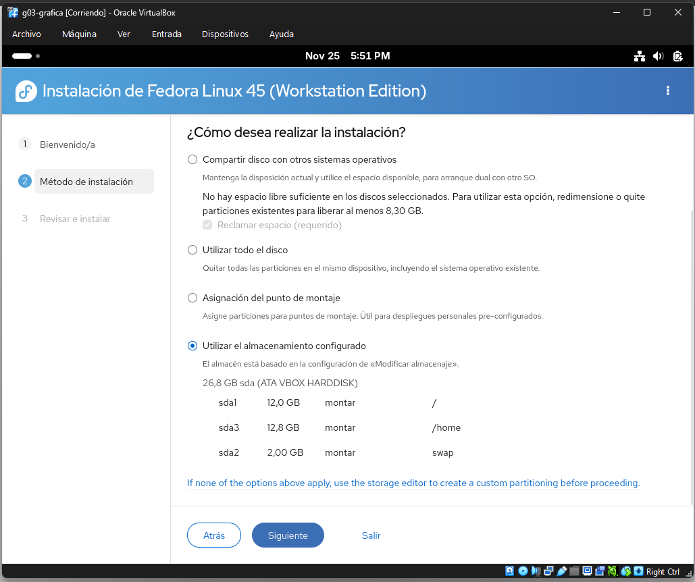

*Figura 1. Configuración final del almacenamiento y confirmación del particionado manual de Fedora Workstation 45.*


*Figura 2. Pantalla final del proceso de instalación de Fedora Workstation 45.*

### 1.4. Verificación del almacenamiento y sistema

Se ejecutaron los siguientes comandos para comprobar la distribución de las particiones, el espacio disponible, los puntos de montaje y la fecha del sistema.

```bash
lsblk
df -h
cat /etc/fstab
date
```

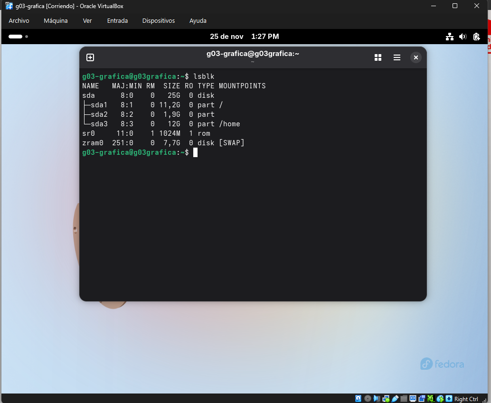

*Figura 3. Salida de `lsblk`, donde se identifican los dispositivos de almacenamiento, sus particiones y los puntos de montaje.*


*Figura 4. Contenido de `/etc/fstab`, utilizado para verificar la configuración de montaje de los sistemas de archivos.*


*Figura 5. Salida de `df -h`, que permite comprobar la capacidad total, el espacio utilizado y el espacio disponible en los sistemas de archivos.*


*Figura 6. Verificación de la fecha y hora configuradas en la máquina virtual.*

### 1.5. Software instalado

Se instalaron navegadores web y editores de texto para disponer de herramientas de navegación, edición y administración del sistema.

| Categoría | Software |
|:---|:---|
| Navegadores | Brave y Google Chrome |
| Editores de texto | Gedit y Vim |


*Figura 7. Proceso de instalación del navegador Brave mediante la terminal.*

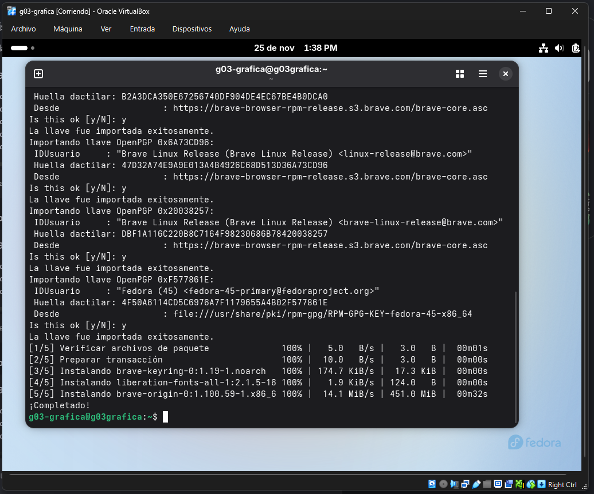

*Figura 8. Continuación y finalización del proceso de instalación de Brave.*

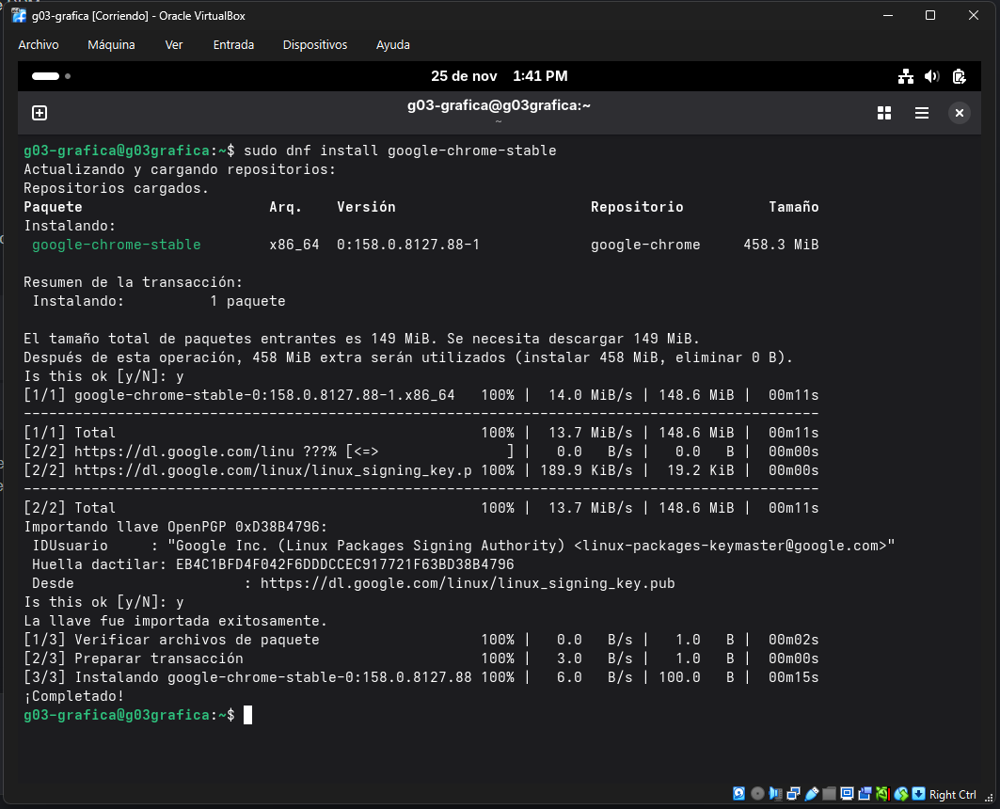

*Figura 9. Instalación de Google Chrome mediante la terminal.*


*Figura 10. Verificación visual de los navegadores Brave y Google Chrome ejecutándose en `g03-grafica`.*

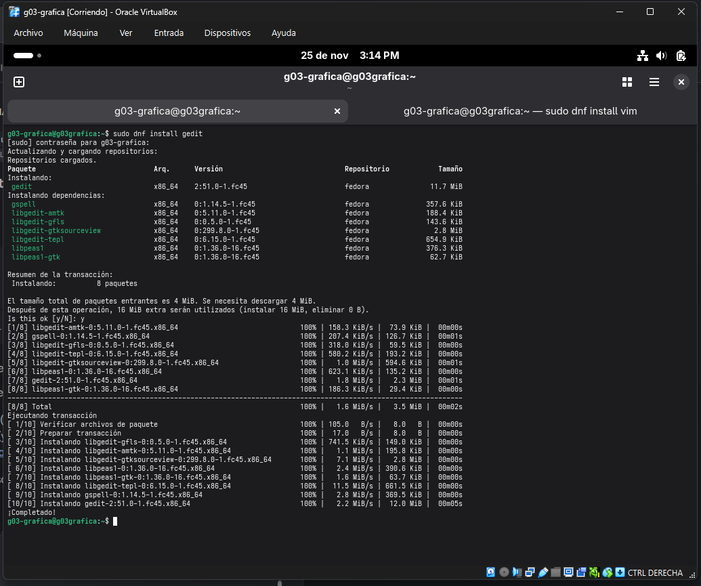

*Figura 11. Instalación del editor de texto Gedit mediante la terminal.*

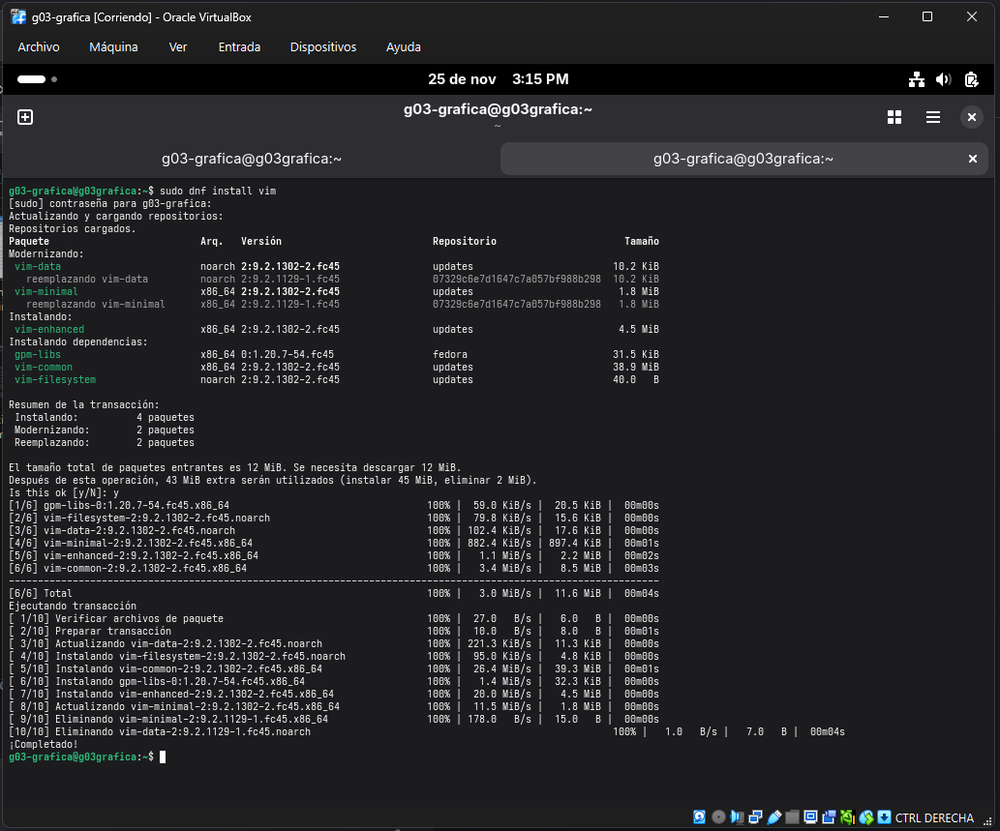

*Figura 12. Instalación del editor de texto Vim mediante la terminal.*


*Figura 13. Verificación de Gedit y Vim ejecutándose correctamente en la máquina virtual gráfica.*

---

## 2. Máquina virtual de consola (`g03-consola`)

Se realizó la instalación de **Ubuntu Server 26.04 LTS**, utilizando particionado manual para separar el sistema de archivos raíz, los datos variables del sistema, la memoria de intercambio y los archivos personales del usuario.

### 2.1. Especificaciones de hardware

| Recurso | Asignación |
|:---|:---|
| Sistema operativo | Ubuntu Server 26.04 LTS |
| Disco virtual | 25 GB |
| CPU | 2 vCPU |
| Memoria RAM | 2 GB |

*Nota: La memoria RAM se ampliará a 3 GB durante el Sprint 3, según los requerimientos previstos para Kubernetes.*

### 2.2. Esquema de particionado

| Partición | Tamaño | Justificación |
|:---|---:|:---|
| `/` | 5 GB | Aloja Ubuntu Server, sus componentes principales y las herramientas necesarias para la administración del sistema. |
| `/var` | 10 GB | Almacena registros, cachés y datos variables generados durante el funcionamiento del sistema. |
| `swap` | 1 GB | Proporciona memoria de intercambio como apoyo a los 2 GB de RAM asignados a la máquina virtual. |
| `/home` | 1 GB | Almacena los archivos personales, configuraciones y proyectos del usuario principal. |

### 2.3. Herramientas instaladas

Se instalaron las herramientas necesarias para la administración del sistema, transferencia de archivos, descarga de recursos, control de versiones y automatización de tareas.

| Herramienta | Función |
|:---|:---|
| `make` | Automatización de tareas mediante archivos Makefile. |
| `rsync` | Sincronización y transferencia eficiente de archivos. |
| `curl` | Transferencia de datos y consulta de recursos mediante URL. |
| `git` | Control de versiones y gestión del repositorio del proyecto. |
| `wget` | Descarga de archivos desde servidores remotos. |

### 2.4. Comandos de instalación y verificación

```bash
sudo apt update

sudo apt install -y make rsync curl git wget

make --version
rsync --version
curl --version
git --version
wget --version

lsblk
df -h
cat /etc/fstab
date
```

### 2.5. Evidencias gráficas

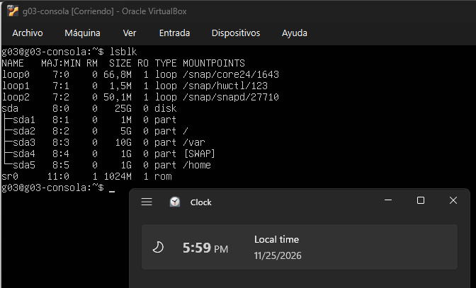

*Figura 14. Comando `lsblk` ejecutado en la terminal de `g03-consola` con prompt y fecha.*


*Figura 15. Comando `df -h` ejecutado en la terminal de `g03-consola` con prompt y fecha.*


*Figura 16. Comando `cat /etc/fstab` ejecutado en la terminal de `g03-consola` con prompt y fecha.*


*Figura 17. Comprobación de `make`, `rsync`, `curl` y `git` mediante sus comandos de versión.*

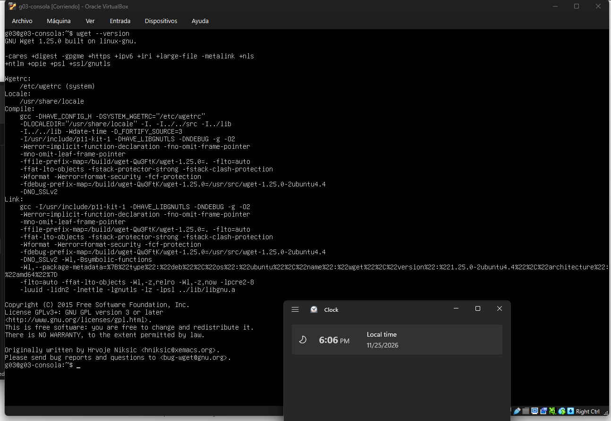

*Figura 18. Comprobación de la instalación de `wget` mediante `wget --version`.*

---

## 3. Configuración de red y conectividad

Se configuraron dos adaptadores de red en cada máquina virtual para proporcionar acceso a internet y comunicación directa entre ambas máquinas.

### 3.1. Configuración de los adaptadores

| Adaptador | Modo de conexión | Función |
|:---|:---|:---|
| Adaptador 1 | NAT | Proporciona acceso a internet mediante la conexión del anfitrión. |
| Adaptador 2 | Red solo-anfitrión (Host-Only) | Permite la comunicación directa entre `g03-grafica` y `g03-consola`. |

### 3.2. Direccionamiento IP

Las direcciones IP se verificaron mediante el comando `ip a`, identificando las interfaces correspondientes a cada adaptador.

| Máquina virtual | Interfaz NAT | IP NAT | Interfaz Host-Only | IP Host-Only |
|:---|:---|:---|:---|:---|
| `g03-grafica` | enp0s3 | 10.0.0.15/24 | enp0s8 | 192.168.56.102/24 |
| `g03-consola` | enp0s3 | 10.0.0.15/24 | enp0s8 | 192.168.56.101/24 |


### 3.3. Comandos de verificación

```bash
ip a
```

Para comprobar la conectividad entre las máquinas virtuales se ejecutó:

```bash
ping -c 4 192.168.56.101
y
ping -c 4 192.168.56.102
```

### 3.4. Evidencias gráficas


*Figura 16. Salida del comando `ip a` en ambas máquinas virtuales. Se identifican las interfaces de red y las direcciones IP asignadas a los adaptadores NAT y Host-Only.*

**Descripción de la evidencia:** La captura permite verificar el direccionamiento IP de las dos máquinas virtuales y distinguir las interfaces destinadas al acceso a internet y a la comunicación interna.

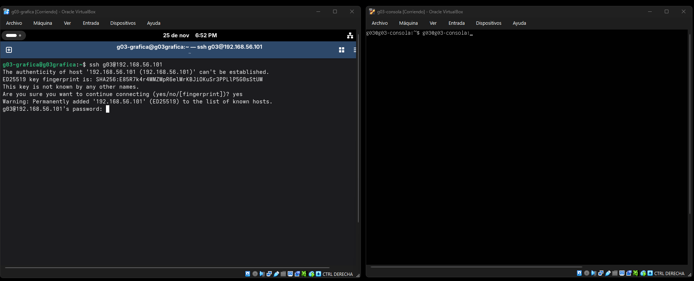

*Figura 17. Pruebas de conectividad mediante `ping` en ambos sentidos: desde `g03-grafica` hacia `g03-consola` y desde `g03-consola` hacia `g03-grafica`.*

**Descripción de la evidencia:** Se comprueba la comunicación bidireccional entre las máquinas virtuales mediante el envío y la recepción de paquetes ICMP, verificando que ambas pueden comunicarse a través de la red Host-Only.

---

## 4. Acceso remoto mediante SSH

Se configuró el servicio SSH para permitir el acceso remoto desde la máquina virtual gráfica (`g03-grafica`) hacia la máquina virtual de consola (`g03-consola`).

La conexión se realizó utilizando el usuario principal de Ubuntu Server y la dirección IP correspondiente a la interfaz Host-Only.

### 4.1. Datos de conexión

| Parámetro | Valor |
|:---|:---|
| Máquina de origen | `g03-grafica` |
| Máquina de destino | `g03-consola` |
| Usuario remoto | g03 |
| Dirección IP de destino | 192.168.56.101 |
| Puerto SSH | 22 |

### 4.2. Comando de conexión

```bash
ssh g03@192.168.56.101
```

### 4.3. Evidencia gráfica

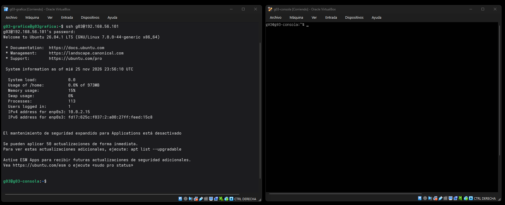

*Figura 18. Sesión SSH establecida desde `g03-grafica` hacia `g03-consola`, mostrando el acceso remoto y el prompt del usuario de Ubuntu Server.*

**Descripción de la evidencia:** Se demuestra que la máquina gráfica puede acceder remotamente a la máquina de consola mediante SSH, utilizando la conectividad proporcionada por el adaptador Host-Only.

---

## 5. Instantáneas de las máquinas virtuales

Una vez finalizadas las instalaciones y configuraciones iniciales, se crearon instantáneas para conservar un estado limpio de cada máquina virtual.

Las instantáneas se registraron con el nombre `instalacion-limpia` y se realizaron con las respectivas máquinas virtuales apagadas.

### 5.1. Instantánea de la máquina gráfica

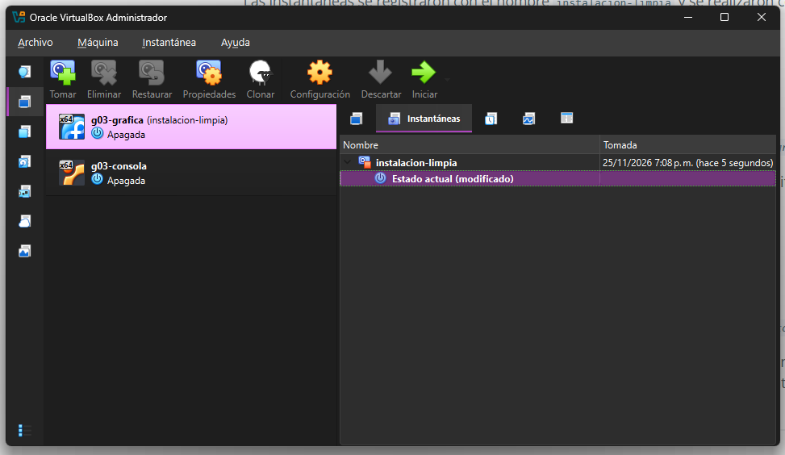

*Figura 19. Instantánea `instalacion-limpia` registrada para la máquina virtual `g03-grafica`.*

**Descripción de la evidencia:** Se verifica la existencia de la instantánea que permite conservar el estado inicial de Fedora Workstation 45.

### 5.2. Instantánea de la máquina de consola

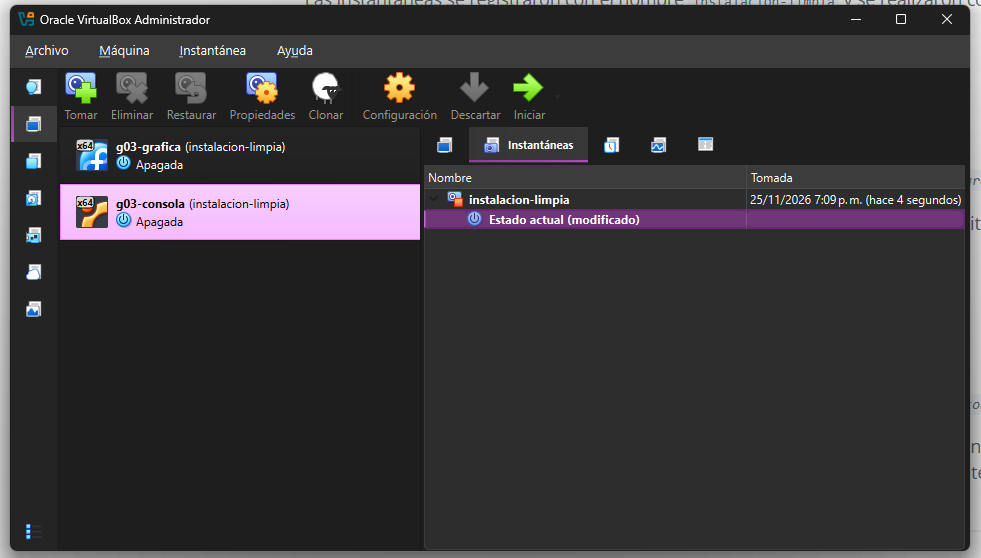

*Figura 20. Instantánea `instalacion-limpia` registrada para la máquina virtual `g03-consola`.*

**Descripción de la evidencia:** Se comprueba que Ubuntu Server cuenta con una instantánea de su estado inicial, permitiendo recuperar la máquina virtual en caso de errores durante los siguientes sprints.

---

## 6. Código de identificación del sprint

El código publicado por el docente en el campus virtual, 48 horas antes del cierre de la entrega, se almacenó en el directorio personal (`$HOME`) del usuario principal de ambas máquinas virtuales.

Para registrar y verificar el código se utilizaron los siguientes comandos:

```bash
echo "XX00-AB12" > codigo_sprint1.txt && cat codigo_sprint1.txt && date
```

Se verificó la existencia del archivo en ambas máquinas virtuales:

```bash
ls -l ~/codigo_sprint1.txt
```

**Ubicación requerida:** `/home/usuario/codigo_sprint1.txt`.

---

## 7. Video de evidencia del Sprint 1

Se presenta un video continuo de **3 minutos**, sin cortes ni ediciones, en el que se demuestra el trabajo realizado durante el Sprint 1.

Durante los primeros 10 segundos, cada integrante debe indicar su nombre, explicar brevemente su participación en el sprint y mostrar su rostro mientras presenta su parte.

El video debe evidenciar:

1. Las características y configuración de `g03-grafica`.
2. Las características y configuración de `g03-consola`.
3. La estructura de particiones de ambas máquinas.
4. Las herramientas instaladas y sus respectivas verificaciones.
5. La configuración de red y las pruebas de conectividad.
6. El acceso remoto mediante SSH.
7. Las instantáneas `instalacion-limpia`.
8. El archivo `codigo_sprint1.txt` en el `$HOME` de ambas máquinas.

### Reproducción del video

<iframe width="560" height="315" src="https://www.youtube.com/embed/FKhjmluvp54" title="Sprint 1 - Montaje de infraestructura" frameborder="0" allowfullscreen></iframe>

**Enlace del video:** https://youtu.be/FKhjmluvp54

---

## 8. Distribución del trabajo y commits

Se documenta la participación de cada integrante en las actividades desarrolladas durante el Sprint 1.

| Integrante | Aportes realizados | Commits |
|:---|:---|:---|
| **Jhoan Mina** | Me encargue de realizar la pagina junto y el diseño de esta misma basándome en la presentada como ejemplo del profesor y estructurándola adecuadamente con todos los requisitos que pedía el sprint 1 para que mis compañeros pudieran seguirla y guiarse en la elaboración de las MV, junto con otras pequeñas correcciones en la estructura | 22 |
| **David Campiño** | Realicé la configuración y documentación de la VM gráfica (g07-grafica), la VM de consola (g03-consola) con particionado manual (/ de 5 GB, /var de 10 GB, swap de 1 GB y /home de 1 GB) e instalación de make, rsync, curl, git y wget, la configuración de red (adaptadores NAT y Host-Only, verificación con ip a y ping en ambos sentidos), la conexión SSH desde la VM gráfica hacia la VM de consola, la creación de las instantáneas instalacion-limpia con las VMs apagadas y el registro del código del sprint. | 15 |
| **Howard López** | Me encargué de grabar y subir el video del Sprint 1, además de realizar la verificación final de requisitos en la lista de chequeo, marcando como completados los puntos finalizados y como pendientes los que faltaban. | 5 |

**Importante:** Cada integrante debe contar con al menos dos commits identificables en el historial del repositorio. Se recomienda registrar los identificadores o enlaces de los commits para facilitar su verificación.

---

## 9. Errores encontrados y fuentes consultadas

Durante el montaje se deben registrar los inconvenientes técnicos que se presentaron, sus posibles causas, las soluciones implementadas y las fuentes utilizadas para resolverlos.

| Error encontrado | Causa probable | Solución implementada | Fuente consultada |
|:---|:---|:---|:---|
| Instalación desatendida de Ubuntu Server sin el particionado manual requerido (`/`, `/var`, `swap` y `/home`) | Seguir el flujo desatendido de la guía del docente sin desactivar la instalación desatendida ni elegir el esquema de almacenamiento personalizado (`Custom storage layout`) exigido por el proyecto | Se desactivó la instalación desatendida, se ingresó al particionado manual del disco y se creó el esquema requerido (`/`, `/var`, `swap` y `/home`) con apoyo de Gemini paso a paso para comprender cada configuración y dejar el sistema funcional | Asistencia interactiva con Gemini (sesión de configuración del proyecto, noviembre de 2026) |


---

## 10. Verificación final de requisitos

| Requisito | Estado |
|:---|:---|
| Instalación de Fedora Workstation 45 | COMPLETADO |
| Instalación de Ubuntu Server 26.04 LTS | COMPLETADO |
| Particionado manual de ambas máquinas | COMPLETADO |
| Instalación y verificación de herramientas | COMPLETADO |
| Configuración de adaptadores NAT y Host-Only | COMPLETADO |
| Conectividad bidireccional mediante ping | COMPLETADO |
| Acceso remoto mediante SSH | COMPLETADO |
| Instantánea `instalacion-limpia` en ambas máquinas | COMPLETADO |
| Archivo `codigo_sprint1.txt` en ambos `$HOME` | PENDIENTE |
| Mínimo 2 commits por integrante | COMPLETADO |
| Video continuo de 3 minutos | COMPLETADO |

---

**Fin del Sprint 1 · Montaje de infraestructura**

