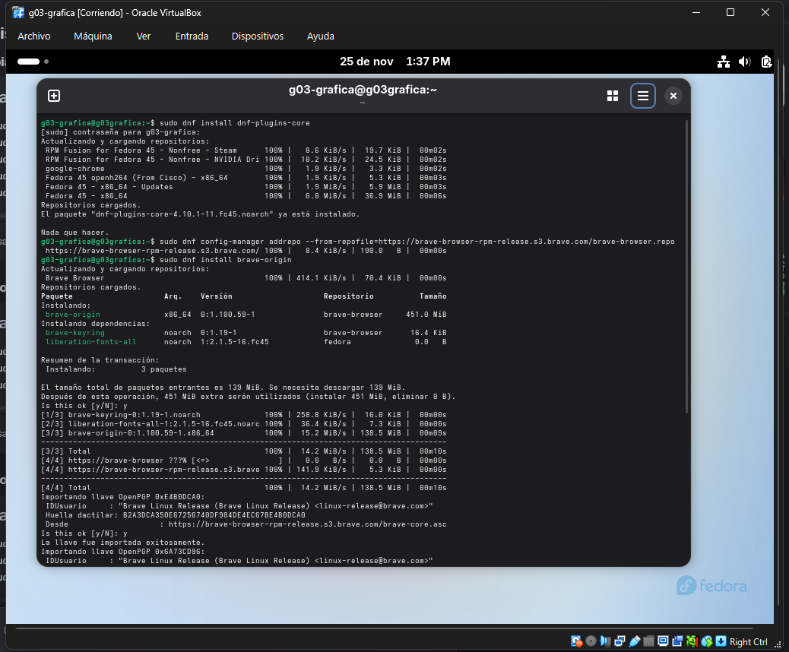

# Sprint 1 · Montaje

[← Volver al inicio](./)

> **Alcance del Sprint 1 (5 puntos):** Montaje de **VM gráfica (`g03-grafica`)**, **VM de consola (`g03-consola`)**, configuración de **red**, **acceso SSH** e **instantáneas limpias**.  
> **Entrega en el campus:** Enlace de este sitio.  
> **Requisitos adicionales:** Video continuo de **3 minutos** al final de esta página, **mínimo 2 commits por integrante** y el archivo `codigo_sprint1.txt` en el `$HOME` del usuario principal de ambas máquinas virtuales.

---

## 1. VM gráfica (`g03-grafica`)

Instalación de **Fedora Workstation 45** con particionado manual (`/`, `swap` y `/home`), sin utilizar la opción de borrar todo el disco.

### Especificaciones de hardware
| Recurso | Asignación |
| :--- | :--- |
| **Sistema operativo** | Fedora Workstation 45 |
| **Disco** | 26,8 GB |
| **CPU** | 3 vCPU |
| **RAM** | 8 GB |

### Esquema de particionado
| Partición | Tamaño | Justificación |
| :--- | :--- | :--- |
| `/` | 12 GB | Alberga Fedora Workstation 45, el entorno gráfico y los paquetes/herramientas instaladas con holgura. |
| `swap` | 2 GB | Apoya la memoria en picos de carga o suspensión sin consumir demasiado espacio del disco. |
| `/home` | 12,8 GB | Separa los archivos de usuario, configuraciones y repositorios/proyectos locales del sistema base. |

### Evidencias gráficas

  
*Figura 1: Confirmación del método de instalación de Fedora Linux Workstation 45 con el almacenamiento configurado.*

  
*Figura 2: Último paso de la instalación de Fedora Workstation 45.*

### Comandos de verificación
```bash
lsblk
df -h
cat /etc/fstab
date
```

  
*Figura 3: Terminal con la salida del comando `lsblk` en `g03-grafica`.*

  
*Figura 4: Terminal con la salida del comando `cat /etc/fstab`.*

  
*Figura 5: Terminal con la salida del comando `df -h`.*

  
*Figura 6: Terminal con la salida del comando `date`.*

### Software instalado
| Navegadores | Editores |
| :--- | :--- |
| Brave | Visual Studio |
| Chrome | Zed |

  
*Figura 7: Instalación de Brave Origin mediante terminal.*

  
*Figura 7.1: Continuación y cierre del comando de instalación para Brave Origin.*

  
*Figura 8: Instalación de Google Chrome mediante terminal.*

  
*Figura 9: Evidencia de navegadores abiertos en `g03-grafica`.*

---

## 2. VM de consola (`g03-consola`)

Instalación de **Ubuntu Server 26.04 LTS** con particionado manual (`/`, `/var`, `swap` y `/home`).

### Especificaciones de hardware
* **Disco:** 25 GB
* **CPU:** 2 vCPU
* **RAM:** 2 GB *(se ampliará a 3 GB en el Sprint 3 para Kubernetes)*

### Esquema de particionado
| Partición | Tamaño | Justificación |
| :--- | :--- | :--- |
| `/` | `[COMPLETAR]` | `[COMPLETAR: una frase]` |
| `/var` | `[COMPLETAR]` | `[COMPLETAR: una frase]` |
| `swap` | `[COMPLETAR]` | `[COMPLETAR: una frase]` |
| `/home` | `[COMPLETAR]` | `[COMPLETAR: una frase]` |

### Herramientas instaladas
`make`, `rsync`, `curl`, `git` y `wget`.

### Comandos de verificación
```bash
lsblk
df -h
cat /etc/fstab
sudo apt update
sudo apt install -y make rsync curl git wget
make --version
rsync --version
curl --version
git --version
wget --version
date
```

### Evidencias gráficas

  
*Figura 10: Salida de `lsblk`, `df -h` y `cat /etc/fstab` en `g03-consola` con prompt y fecha.*

> `[COMPLETAR: qué muestra la captura]`

  
*Figura 11: Verificación de versiones de `make`, `rsync`, `curl`, `git` y `wget`.*

> `[COMPLETAR: qué muestra la captura]`

---

## 3. Red

Cada máquina virtual cuenta con dos adaptadores de red:
* **Adaptador 1:** **NAT** (acceso a internet).
* **Adaptador 2:** **Red solo-anfitrión** (comunicación directa entre `g03-grafica` y `g03-consola`).

> `[COMPLETAR: qué direcciones IP tomó cada interfaz y si hubo que configurar algo a mano]`

### Comandos de prueba
```bash
ip a
ping -c 4 <IP-DE-LA-OTRA-VM>
```

### Evidencias gráficas

  
*Figura 12: Salida de `ip a` en ambas VMs mostrando las direcciones asignadas en cada interfaz.*

> `[COMPLETAR: qué muestra la captura]`

  
*Figura 13: Pruebas de conectividad `ping` bidireccional entre `g03-grafica` y `g03-consola`.*

> `[COMPLETAR: qué muestra la captura]`

---

## 4. SSH

Acceso remoto por **SSH** desde la VM gráfica (`g03-grafica`) hacia la VM de consola (`g03-consola`).

> `[COMPLETAR: usuario y dirección IP utilizados]`

### Comando de conexión
```bash
ssh usuario@direccion-de-la-consola
```

### Evidencia gráfica

  
*Figura 14: Sesión SSH activa conectada desde `g03-grafica` hacia `g03-consola`.*

> `[COMPLETAR: qué muestra la captura]`

---

## 5. Instantáneas

Se creó una instantánea denominada `instalacion-limpia` en cada máquina virtual una vez finalizada la instalación y con la VM apagada.

  
*Figura 15: Instantánea `instalacion-limpia` registrada en `g03-grafica`.*

> `[COMPLETAR: qué muestra la captura]`

  
*Figura 16: Instantánea `instalacion-limpia` registrada en `g03-consola`.*

> `[COMPLETAR: qué muestra la captura]`

---

## Código del sprint

El código publicado por el docente en el campus (48 horas antes del cierre) se almacenó en el directorio `home` del usuario principal de ambas máquinas virtuales y se muestra en el video de evidencia.

```bash
echo "CÓDIGO" > codigo_sprint1.txt
cat codigo_sprint1.txt
date
```

---

## Video del sprint (3 minutos)

Grabación continua y sin cortes. En los primeros **10 segundos** cada integrante indica su nombre, qué realizó en el sprint y muestra su rostro mientras expone su parte.

<iframe width="560" height="315" src="https://www.youtube.com/embed/ID_DEL_VIDEO" title="Sprint 1 - Montaje" frameborder="0" allowfullscreen></iframe>

---

## Lo que hizo cada integrante en este sprint

| Integrante | Aportes en el sprint | Commits |
| :--- | :--- | :--- |
| **Jhoan Mina** | `[COMPLETAR]` | `[COMPLETAR]` |
| **David Campiño** | `[COMPLETAR]` | `[COMPLETAR]` |
| **Howard López** | `[COMPLETAR]` | `[COMPLETAR]` |

---

## Errores encontrados y fuentes consultadas

| Error | Causa probable | Solución | Fuente (título, enlace y fecha de consulta) |
| :--- | :--- | :--- | :--- |
| `[COMPLETAR]` | `[COMPLETAR]` | `[COMPLETAR]` | `[COMPLETAR]` |
