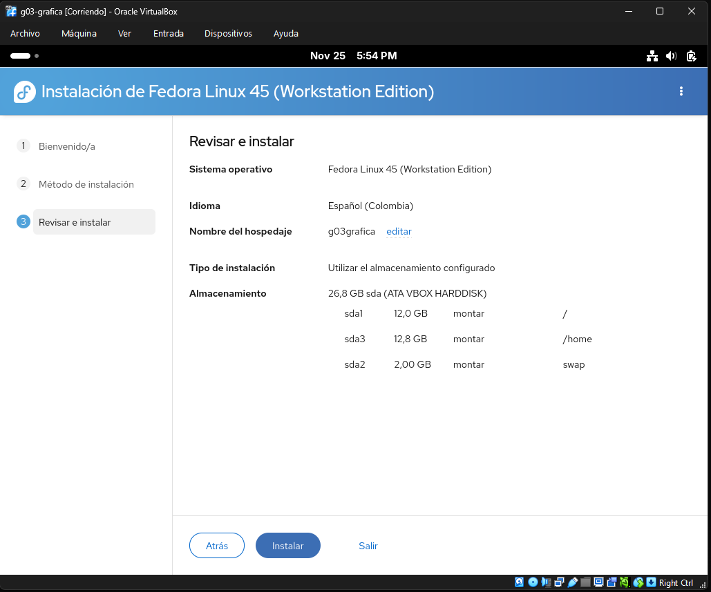
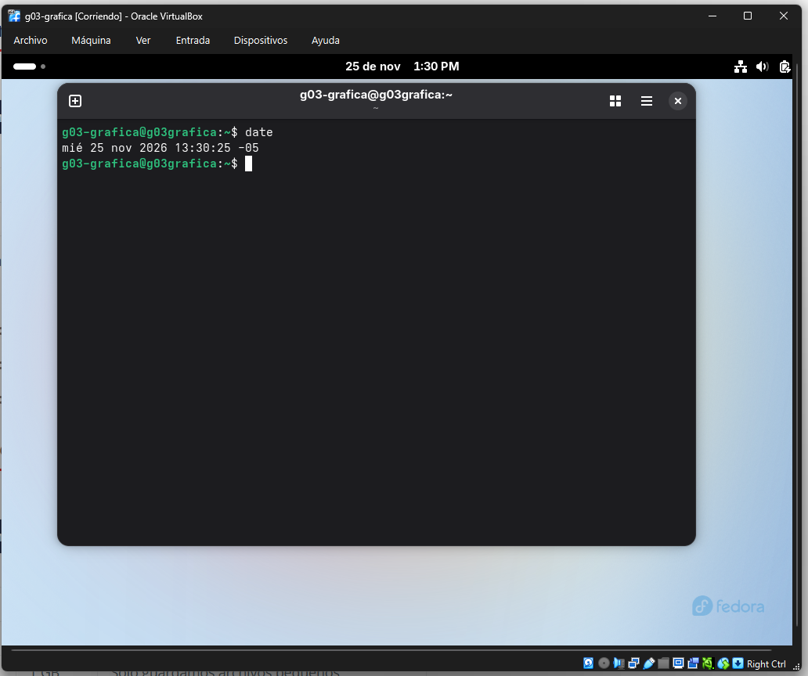

# Sprint 1 · Montaje

[Volver al inicio](./)

- **Qué se pide en este sprint (5 puntos):** VM gráfica, VM de consola, red, SSH e instantáneas.
- **Qué se entrega en el campus:** el enlace de este sitio.
- **Qué más:** el video de 3 minutos (al final de esta página), 2 commits por integrante y el archivo `codigo_sprint1.txt` en el home del usuario principal de las dos VMs.

## 1. VM gráfica (g03-grafica)

Instalamos Fedora Workstation 45 con particionado manual: `/`, swap y `/home`. No usamos «borrar el disco». La VM tiene disco de 26,8 GB, 3 CPU y 8 GB de RAM.

| Partición | Tamaño | Por qué |
|---|---|---|
| / | 12 GB | Alberga Fedora Workstation 45, entorno gráfico y paquetes/herramientas instaladas con holgura. |
| swap | 2 GB | Apoya la memoria en picos de carga o suspensión sin gastar demasiado espacio del disco de 25 GB. |
| /home | 12,8 GB | Guarda archivos de usuario, configuraciones y repositorios/proyectos locales de forma separada. |

  
*Figura 1: Se visualiza la confirmación del método de instalación de Fedora Linux Workstation 45, con el respectivo almacenamiento configurado.*

  
*Figura 2: Se visualiza el último paso de la instalación.*

Comandos: `lsblk`, `df -h`, `cat /etc/fstab`, `date`

  
*Figura 3: Se visualiza la terminal con el comando `lsblk` ejecutado.*

  
*Figura 4: Se visualiza la terminal con el comando `cat /etc/fstab` ejecutado.*

  
*Figura 5: Se visualiza la terminal con el comando `df -h` ejecutado.*

  
*Figura 6: Se visualiza la terminal con el comando `date` ejecutado.*

Dos navegadores y dos editores instalados:
| Navegador | Editor |
| :--- | :--- |
| Brave | Visual Studio |
| Chrome | Zed |

  
*Figura 7: Se visualiza la instalación de Brave Origin mediante la terminal.*

  
*Figura 7.1: Se visualiza el resto del comando de instalación para Brave Origin.*

  
*Figura 8: Se visualiza la instalación de Chrome por medio de la terminal.*

  
*Figura 9: Evidencia de ambos navegadores abiertos en la VM.*

## 2. VM de consola (g03-consola)

Instalamos Ubuntu Server 26.04 LTS con particionado manual: `/`, swap, `/home` y `/var`. Disco de 25 GB, 2 CPU y 2 GB de RAM (pasa a 3 GB en el Sprint 3, para Kubernetes).

| Partición | Tamaño | Por qué |
|---|---|---|
| / | [COMPLETAR] | [COMPLETAR: una frase] |
| /var | [COMPLETAR] | [COMPLETAR: una frase] |
| swap | [COMPLETAR] | [COMPLETAR: una frase] |
| /home | [COMPLETAR] | [COMPLETAR: una frase] |

Herramientas instaladas: make, rsync, curl, git y wget.

Comandos: `lsblk`, `df -h`, `cat /etc/fstab`, `sudo apt update`, `sudo apt install -y make rsync curl git wget`, `make --version`, `rsync --version`, `curl --version`, `git --version`, `wget --version`, `date`

[COMPLETAR: qué muestra la captura]

[COMPLETAR: qué muestra la captura]

## 3. Red

Cada VM tiene dos adaptadores: el 1 en NAT (internet) y el 2 en red solo-anfitrión (para verse entre ellas). [COMPLETAR: qué direcciones tomó cada una y si hubo que configurar algo a mano]

Comandos: `ip a` en cada VM y `ping` en los dos sentidos.

[COMPLETAR: qué muestra la captura]

[COMPLETAR: qué muestra la captura]

## 4. SSH

Entramos por SSH desde la VM gráfica a la VM de consola. [COMPLETAR: usuario y dirección usados]

Comando: `ssh usuario@direccion-de-la-consola`

[COMPLETAR: qué muestra la captura]

## 5. Instantáneas

Una por VM, llamada `instalacion-limpia`, tomada con la VM apagada y la instalación terminada.

[COMPLETAR: qué muestra la captura]

[COMPLETAR: qué muestra la captura]

## Código del sprint

El docente publicó el código en el campus 48 horas antes del cierre. Lo guardamos en las dos VMs y lo mostramos en el video.

Comandos: `echo "CÓDIGO" > codigo_sprint1.txt`, `cat codigo_sprint1.txt` y `date`

## Video del sprint (3 minutos)

Pantalla continua y sin cortes. Cada integrante muestra su parte, dice su nombre y qué hizo en los primeros 10 segundos, y aparece su cara.

<iframe width="560" height="315" src="https://www.youtube.com/embed/ID_DEL_VIDEO" title="Sprint 1" frameborder="0" allowfullscreen></iframe>

## Lo que hizo cada integrante en este sprint

| Integrante | Qué hizo | Commits |
|---|---|---|
| Jhoan Mina | [COMPLETAR] | [COMPLETAR] |
| David Campiño | [COMPLETAR] | [COMPLETAR] |
| Howard López | [COMPLETAR] | [COMPLETAR] |

## Errores encontrados y fuentes consultadas

| Error | Causa probable | Solución | Fuente (título, enlace y fecha de consulta) |
|---|---|---|---|
| [COMPLETAR] | [COMPLETAR] | [COMPLETAR] | [COMPLETAR] |
